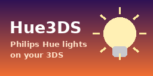

# PhilipsHue3DS

**Control your Philips Hue lights from a Nintendo 3DS.**
Rooms, colour and brightness presets, and a party mode that makes your lamps dance to music through the 3DS microphone.



## Features

- **Lights:** switch lamps on and off, with sliders for brightness, colour and saturation
- **Rooms:** control a whole room, or all lights at once
- **Presets:** 10 one-tap presets
  - Brightness moods: Super bright, Daylight, Medium, Relax, Dimmed, Nightlight
  - Colour palettes: Sunset, Tropical, Candy, Funky (each lamp in a room gets a different colour)
- **Party mode:** the 3DS microphone listens to the room; small beats light up one lamp at a time, big beats switch every lamp at once
- **Rename lights:** names sync back to the bridge and the official Hue app
- Installable `.cia` with its own HOME Menu icon, banner and jingle

## Requirements

- A Nintendo 3DS / 2DS / New 3DS with custom firmware (Luma3DS): see [3ds.hacks.guide](https://3ds.hacks.guide)
- A **Philips Hue Bridge** on the same Wi-Fi network as the 3DS

## Install

1. Download `PhilipsHue3DS.zip` from the [Releases](../../releases) page.
2. Unzip it onto your SD card. It contains `cia/hue3ds.cia` and `3ds/hue3ds.3dsx`.
3. Install `cia/hue3ds.cia` with FBI so it appears on your HOME Menu, **or** launch `hue3ds.3dsx` from the Homebrew Launcher.
4. Open the app and follow the setup screen.
5. Press the link button on your Hue Bridge when asked. The pairing is saved on the SD card.

## Controls

| Input | Action |
| --- | --- |
| Touch screen | Everything: lights, sliders, rooms, presets |
| L / R | Switch tabs (Lights / Rooms) |
| D-pad | Select a light |
| A | Toggle the selected light |
| X | Cycle through presets |
| SELECT | Setup / re-pair |
| START | Exit |

## Building

Requires [devkitPro](https://devkitpro.org/) with devkitARM, libctru and citro2d/citro3d.

```sh
make             # builds the .3dsx
./build-cia.sh   # builds hue3ds.cia (needs makerom and bannertool in PATH)
```

## Notes

- White-only bulbs ignore the colour sliders. That's normal Hue behaviour.
- The Hue Bridge limits how many commands it accepts per second, so party mode pulses on the beat rather than strobing.

## Credits

- Made by **Ryan**: [YouTube](https://www.youtube.com/@Ryan3DSMods) · [TikTok](https://www.tiktok.com/@ryan3dsmods)
- Built with [devkitPro](https://devkitpro.org/) (libctru, citro2d, citro3d)

### How AI was used

The code was largely written with Claude, Anthropic's AI assistant. Ryan came up with the project and its features, built every version himself, and tested it on his own New 3DS and Hue lights.

## License

MIT. See [LICENSE](LICENSE).

---

Unofficial fan project. Not affiliated with or endorsed by Philips Hue / Signify or Nintendo.
